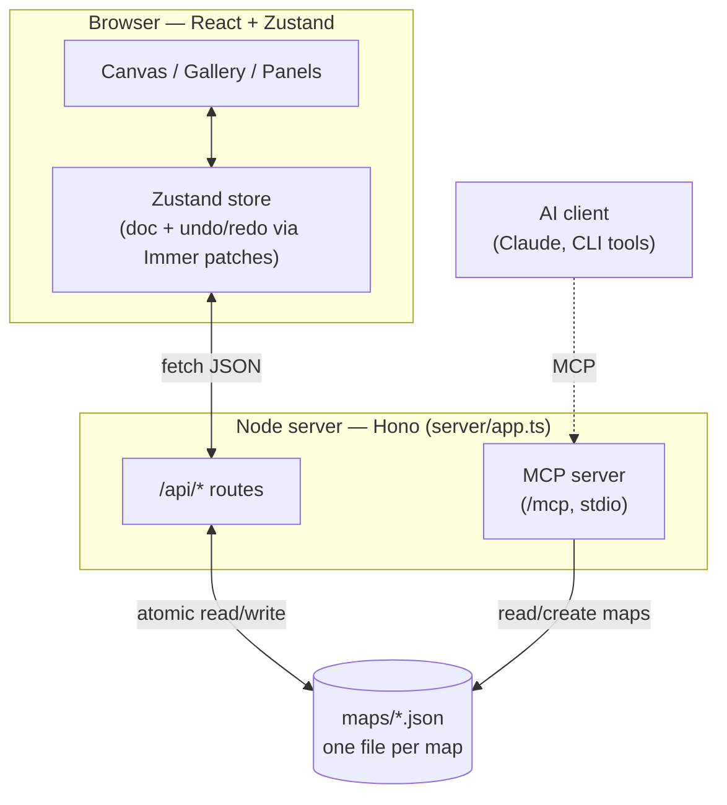

# Architecture

A tour of how mind-map is put together, for anyone reading or modifying the code.
For build/run conventions and how to add a feature, see [CONTRIBUTING.md](CONTRIBUTING.md).

## The big picture

mindmap-mcp is a single-page React app backed by a small [Hono](https://hono.dev) HTTP
server. Maps are plain JSON files on disk — there is no database, no external service,
and no API key. The same server feeds the browser canvas and any MCP-connected LLM.



The server is **framework-only** (`server/app.ts` never calls `serve()`). It is mounted
two ways from the same code:

- **Dev:** as Vite middleware ([`server/vite-plugin.ts`](server/vite-plugin.ts)), so the
  UI and API share one port (5454) with hot-module reload.
- **Production:** wrapped by [`server/standalone.ts`](server/standalone.ts),
  which serves the built assets and calls `serve()` (`pnpm start`).

This split keeps the request handlers identical in both environments.

## Frontend

- **Stack:** Vite + React 19 + TypeScript, [Zustand](https://github.com/pmndrs/zustand)
  for state.
- **The document (`doc`)** is the in-memory representation of the open map. Its persisted
  shape is `MapFile` (see [Data model](#data-model)); at runtime it also carries selection,
  collapse state, etc.
- **Undo/redo** is built on Immer's `produceWithPatches`. Every mutation runs through
  `store.runCommand`, which records the forward patches and their inverses, so undo and
  redo are exact and selection is restored from history. **Nothing mutates `doc` outside
  this path** — that invariant is what makes history correct.
- **Live sync** ([`src/state/livesync.ts`](src/state/livesync.ts)): edits made through the
  MCP server arrive over SSE as `map-ops` batches and are replayed through `runCommand`
  using the same shared op vocabulary ([`src/model/ops.ts`](src/model/ops.ts): node ops +
  relationship ops) the server applied — one batch = one history entry, so Ctrl+Z undoes
  an AI edit (or a whole `apply_ops` batch) like a local edit. The server applies batches
  all-or-nothing; the browser replays them best-effort per op (its doc may have diverged).
  After each batch the store is marked dirty so autosave re-asserts the browser's doc (the
  union of both sides) to disk — the browser wins conflicts.
- **View state is ephemeral.** Hoist (`⌘.`), the search panel (`⌘F`), and the pinned
  dimming filter live in the store next to selection — never inside `doc` — so they are
  not persisted, not undoable, and invisible to MCP clients. The canvas lays out a *view*
  of the doc ([`src/model/search.ts`](src/model/search.ts) `viewScope` re-roots at the
  hoisted node and hides floating trees); commands still mutate the full doc, so node ids
  stay valid across hoisting.
- **Layout is a pure function.** [`src/layout/layout.ts`](src/layout/layout.ts) maps
  `(doc, sizes) → rectangles`. Node sizes come from
  [`src/layout/measure.ts`](src/layout/measure.ts), which measures text in an offscreen div
  using the same `.node-text` CSS as the real nodes — and the same `renderNodeContent`
  HTML (inline markdown + optional icon, cache keyed by both) — so measured and rendered
  sizes always agree. Four structures are supported: `right` (logic chart, default), `balanced` (both
  sides of the root), `down` (org chart), and `timeline` (roadmap). **Floating trees** always
  lay out as compact right-trees, placed by translating each tree so its root lands on the
  stored `pos`. The result includes a
  `dirs` map saying which way each branch grows; rendering, `hjkl` navigation, and drag-drop
  all key off it.

## Backend

A handful of focused modules under [`server/`](server):

| File | Responsibility |
| --- | --- |
| `app.ts` | The Hono app and all `/api/*` routes. Framework-only — mounted by the others. |
| `vite-plugin.ts` | Mounts `app` as Vite middleware in dev. |
| `standalone.ts` | Production entry: serves built assets + `serve()` (`pnpm start`). |
| `storage.ts` | Maps CRUD with atomic writes (unique temp file, rename), serialized per map (`withMapLock` / `updateMap`) so parallel MCP calls and autosave never lose updates. |
| `mcp-server.ts` | **Inbound** MCP server exposing mind-map tools to AI clients, including surgical node edits (see [MCP.md](MCP.md)). |
| `mcp-stdio.ts` | stdio entry point for the inbound MCP server. |
| `presence.ts` | In-memory "what the user is looking at" (open map, selection, hoist), reported by the tab via `POST /api/view` and read by the `get_active_view` MCP tool. |
| `events.ts` | In-process pub/sub for external map edits (`map-ops` batches), fanned out to browser tabs over SSE (`GET /api/events`). |

The server imports shared types from `src/model/` only; it has no other dependency on the
frontend.

## Data model

Maps are pretty-printed JSON, one file per map, named `maps/<id>.json`. This is the whole
persistence layer — friendly to git, backups, and hand-editing.

```ts
interface MapFile {
  schemaVersion: 2;
  id: string;            // map id, also the file name
  title: string;
  createdAt: string;     // ISO 8601
  updatedAt: string;     // ISO 8601
  layout?: 'right' | 'balanced' | 'down' | 'timeline';
  pinned?: boolean;
  relationships?: Relationship[];
  groups?: Group[];
  root: FileNode;
  /** Floating trees (XMind floating topics); pos = world coords of each tree root. */
  floating?: Array<{ pos: { x: number; y: number }; root: FileNode }>;
  /** Freeform canvas elements — sticky notes, text, shapes — outside every tree. */
  elements?: CanvasElement[];
}

interface FileNode {
  id: string;
  text: string;          // node label; supports inline markdown
  collapsed?: boolean;
  color?: string;        // palette name (NODE_COLORS) — subtle tint on the canvas
  icon?: string;         // leading emoji, rendered before the text (never part of text)
  note?: string;         // hidden longer text — dot on canvas, shown in the ⇧I inspector
  tags?: string[];       // searchable labels (find_nodes)
  children: FileNode[];
}

interface Relationship {
  id: string;
  from: string;          // source node or element id
  to: string;            // target node or element id
  label?: string;
}

interface Group {
  id: string;
  members: string[];     // node ids, possibly from different parents; always ≥ 2
  label?: string;
  color?: string;        // palette name (NODE_COLORS)
}

interface CanvasElement {
  id: string;
  kind: 'sticky' | 'text' | 'rect' | 'ellipse';
  text: string;          // inline markdown; may be empty for shapes
  w: number; h: number;  // h is a minimum — text-bearing kinds grow to fit
  x: number; y: number;  // free: world top-left; anchored: nudge from the anchored spot
  anchor?: { nodeId: string; side: 'right' | 'left' | 'above' | 'below' }; // follows + deleted with the node
  color?: string;        // palette name
}
```

- The **root** node holds the map title.
- **Relationships** are free, directional arrows between *any* two nodes — not parent/child
  links. They live in the JSON but are deliberately excluded from markdown *copy/paste*,
  which stays tree-only. (MCP reads are different: `read_map_markdown`/`get_subtree` append
  a `## Relationships` section so connected ideas are visible to AI clients.)
- **Groups** are dashed boundaries around sets of nodes (possibly from different parents),
  rendered as a rounded convex hull of the member rects (`src/canvas/groupHull.ts`) behind
  the tree. They enclose exactly the listed members — not their subtrees; members hidden by
  collapse or hoist simply drop out of the hull. Deleting nodes prunes members, and a group
  shrunk below 2 dissolves (in `removeSubtree`, so MCP and browser converge). MCP reads
  append a `## Groups` section like relationships.
- Schema migrations live in [`src/model/migrate.ts`](src/model/migrate.ts); bump
  `schemaVersion` and add a migration when the shape changes.

## Directory map

```
src/
  api/        client-side wrappers around the /api/* routes
  canvas/     rendering: nodes, edges, relationship arrows, the node editor,
              drag-and-drop, viewport/pan-zoom, layout cache
  components/  panels and overlays: node inspector, help, status bar, toasts
  gallery/    the Esc map menu: sections, fuzzy search, recents
  hotkeys/    keymap data + dispatcher that resolves key combos to command ids
  layout/     pure layout function + text measurement
  model/      types, doc helpers, markdown (block + inline), migrations
  state/      Zustand store, Immer command functions, command registry, autosave
server/       Hono app and the modules described above
bin/          the `mindmap` CLI — per-project sessions (`up`, `claude`), a stdio MCP entry
              for spawning clients (`stdio`), and per-client config snippets (`config`)
maps/         your map JSON files (git-ignored except the demo welcome map)
```

## How a keystroke becomes a change

The command pattern ties the layers together:

1. A key combo is matched by the **dispatcher** ([`src/hotkeys/dispatcher.ts`](src/hotkeys/dispatcher.ts))
   against the **keymap** ([`src/hotkeys/keymap.ts`](src/hotkeys/keymap.ts)), resolving to a
   **command id**.
2. The id is looked up in the **registry** ([`src/state/registry.ts`](src/state/registry.ts)),
   which runs the command — typically `store.runCommand(name, draft => ...)`.
3. The draft function (pure, from [`src/state/commands.ts`](src/state/commands.ts)) mutates an
   Immer draft of `doc`; `produceWithPatches` captures patches for undo/redo.
4. The store notifies React; layout recomputes; autosave
   ([`src/state/autosave.ts`](src/state/autosave.ts)) persists the map to disk.

Adding a feature usually means: a command in the registry + a keymap binding (+ a draft
function if it mutates the doc). See [CONTRIBUTING.md](CONTRIBUTING.md#adding-a-feature).
