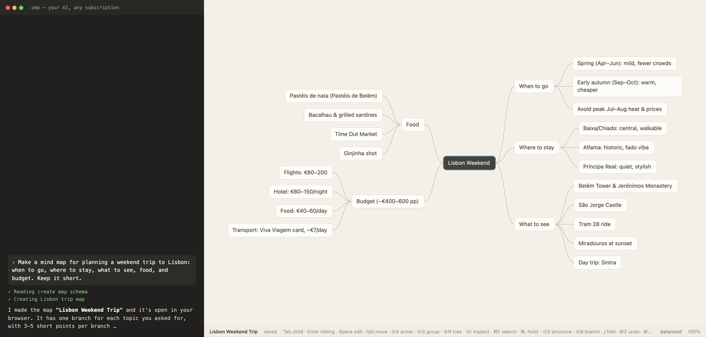
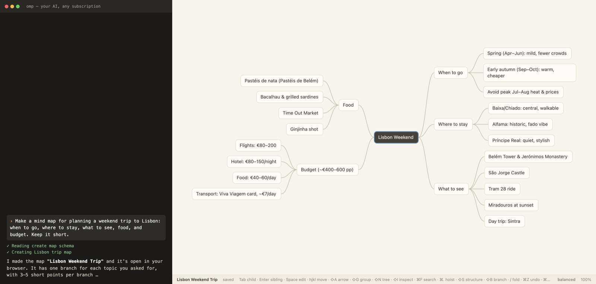
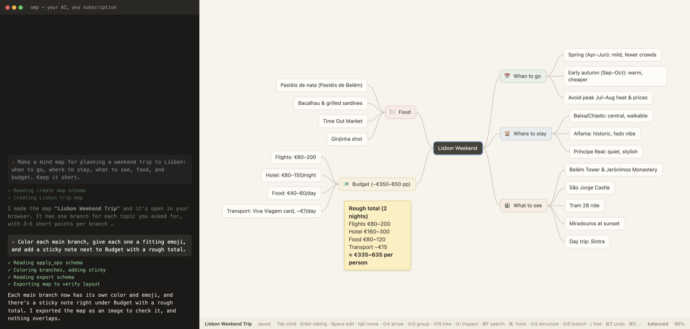
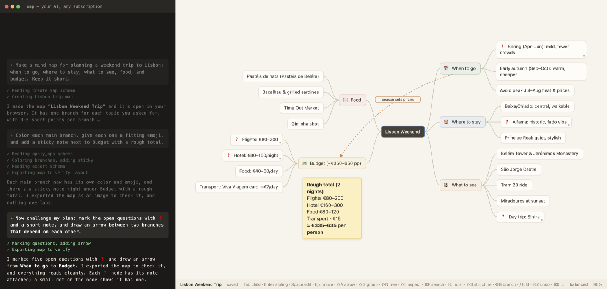
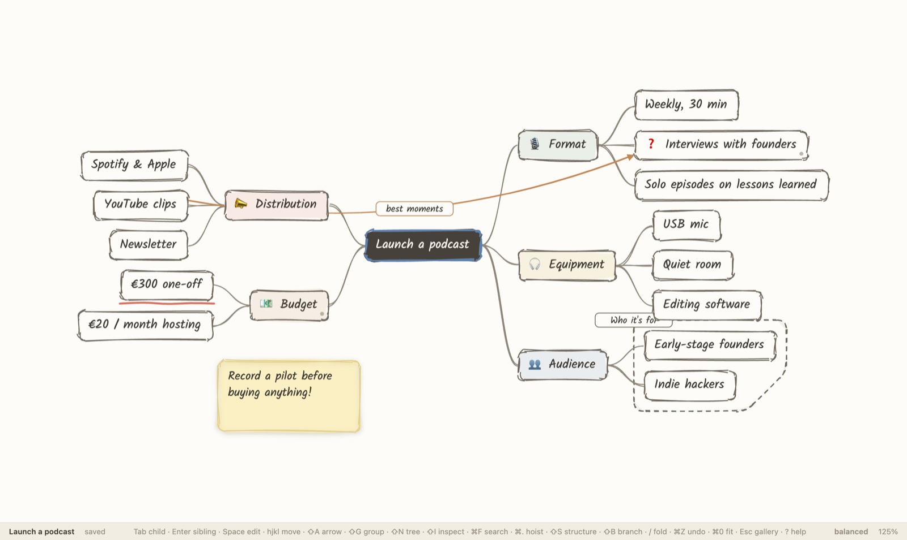
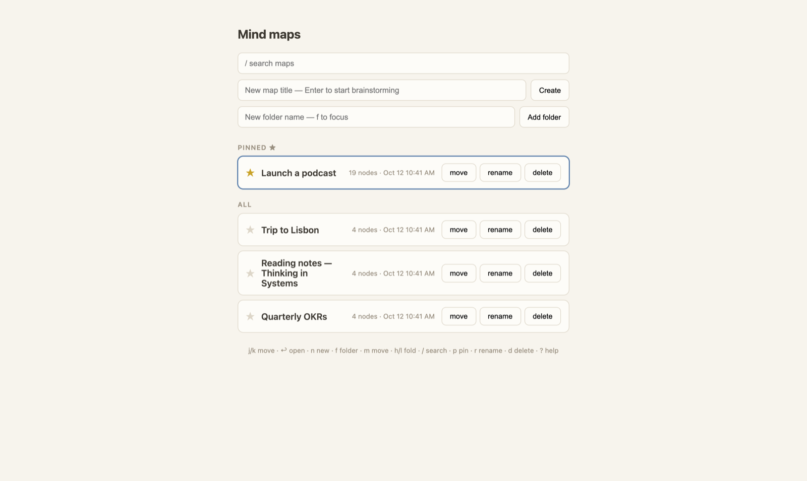

# mind-map

**A visual whiteboard for your ideas that your AI draws for you — live, on your own computer.**

**You chat, the map draws itself.** Describe what you want in plain words — *"make a mind
map for planning a weekend in Lisbon"* — and your AI assistant builds it in front of you:
topics, colors, emoji, sticky notes, arrows, open questions. Then keep talking to refine it.
You can also edit by hand at any time, and `⌘Z` undoes anything the AI did. Think
[Excalidraw](https://excalidraw.com) or [XMind](https://xmind.app), but made to be driven by
conversation.

<p align="center"></p>
<p align="center"><em>A real session: the conversation with the AI on the left, the map in your browser on the right.</em></p>

- **Use the AI subscription you already have** — Claude, ChatGPT, Gemini, GitHub Copilot…
  no extra account, nothing to pay for this tool.
- **Private by default** — your maps are plain files on your computer. There is no cloud and
  no sign-up. (Your AI app sends what it reads to its own provider, as it always does.)
- **Free and open source** ([MIT](LICENSE)).

## How it works: just ask

Each picture below is one message, exactly as typed, with the AI's real reply (shortened)
and what it did to the map. Nothing was edited by hand.

**1. Ask for a map.** *"Make a mind map for planning a weekend trip to Lisbon: when to go,
where to stay, what to see, food, and budget. Keep it short."*

<p align="center"></p>

**2. Shape it.** *"Color each main branch, give each one a fitting emoji, and add a sticky
note next to Budget with a rough total."* — the AI even exports a picture of the map to
check its own layout.

<p align="center"></p>

**3. Think with it.** *"Now challenge my plan: mark the open questions with ❓ and a short
note, and draw an arrow between two branches that depend on each other."*

<p align="center"></p>

Other things to ask: *"expand the Food branch"*, *"turn this into a roadmap"*, *"quiz me on
this map"*, *"export it as a PNG"*. And when you prefer the hand-drawn look, press `⇧D`:

<p align="center"></p>

## Works with the AI you already pay for

mind-map doesn't contain an AI itself — it plugs into an AI assistant app through an open
standard called [MCP](https://modelcontextprotocol.io). The easiest route is **omp**, a free
assistant app that can sign in with almost any subscription:

| You have… | Sign in to omp with… |
| --- | --- |
| **Claude** Pro or Max | Anthropic |
| **ChatGPT** Plus or Pro | OpenAI Codex |
| **Google** account (Gemini) | Google |
| **GitHub Copilot** | GitHub Copilot |
| An API key (OpenAI, Anthropic, Gemini, OpenRouter, Mistral, Groq, xAI…) | the matching provider |

Already use **Claude Code**, **Codex**, **Gemini CLI**, **Claude Desktop** or **opencode**?
Those work too — see [Use a different AI app](#use-a-different-ai-app).

## Install (about 10 minutes, once)

You'll type a few commands into the **Terminal** — copy each line, paste it, press Enter.

> **Open the Terminal:** on a Mac press `⌘ Space`, type *Terminal*, press Enter. On Linux
> it's in your applications menu. On Windows, install [WSL](https://learn.microsoft.com/windows/wsl/install)
> first and use its Ubuntu terminal.

**1. Install Node.js** — download the **LTS** installer from [nodejs.org](https://nodejs.org)
and run it like any other app. Check it worked:

```bash
node --version        # should print v20 or higher
```

**2. Install omp and sign in with your subscription:**

```bash
curl -fsSL https://omp.sh/install | sh
omp                   # starts omp — type /login, pick your provider, follow the browser prompt
```

Type `/exit` (or press `Ctrl+C` twice) to leave omp once you're signed in.
(Homebrew users can `brew install can1357/tap/omp` instead. More on omp: [github.com/can1357/oh-my-pi](https://github.com/can1357/oh-my-pi).)

**3. Download and install mind-map:**

```bash
git clone https://github.com/JoanClaverol/mind-map.git ~/mind-map
~/mind-map/install.sh
```

> On a Mac, the first `git` command may offer to install the "command line developer
> tools" — accept, wait for it to finish, and run the line again.

The installer sets everything up and adds a `mindmap` command. **Close the Terminal window
and open a new one** so the command is found.

## Make your first map

```bash
mkdir -p ~/Mindmaps && cd ~/Mindmaps
mindmap omp
```

Your browser opens on an empty map gallery, and omp starts in the Terminal, already
connected. Put the two windows side by side and ask, in your own words:

> *"Make a mind map about launching a podcast: format, equipment, audience, distribution and
> budget. Add a sticky note with the most important advice."*

Watch it appear. Then keep going:

> *"Color the branches, mark open questions with ❓ and a short note."*

> *"Don't add anything — challenge this map: where is my thinking weak?"*

> *"Quiz me on this map, one question at a time."*

When you're done, quit omp (`/exit`) — the map server stops with it. Your maps are saved as
files in the `mindmaps` folder of wherever you ran the command, so `mindmap omp` in another
folder gives that project its own maps.

**One-line routines.** omp also has ready-made commands — type them instead of a prompt:

| Command | What it does |
| --- | --- |
| `/mind-map:build_map topic="Weekend in Lisbon"` | A polished new map on a topic |
| `/mind-map:expand_branch focus="costs"` | Grows the branch you've selected in the browser |
| `/mind-map:challenge_map` | Marks the weak spots with ❓, adds nothing |
| `/mind-map:quiz_me` | Examines your understanding and grades it on the map |

**Editing by hand.** Click a topic and just type to rename it, `Tab` adds a child, `Enter`
a sibling, arrow keys move around, `Delete` removes. `⇧P` adds a sticky note, `⇧F` picks up
a pen to draw, `⌘Z` undoes (your edits *and* the AI's). Press `?` any time to see every
shortcut. `Esc` takes you back to the gallery:

<p align="center"></p>

## Use a different AI app

Any app that supports MCP can drive mind-map. Two of them have a one-command launcher:

```bash
mindmap omp           # omp (recommended — works with every subscription above)
mindmap claude        # Claude Code (Claude subscription)
```

For everything else, start the canvas with `mindmap up` (it prints its address, e.g.
`http://localhost:5460`), then add mind-map to your app. `mindmap config <app>` prints the
exact text to paste, with the paths on your computer filled in:

| App | Command | Where to paste it |
| --- | --- | --- |
| Codex CLI (ChatGPT subscription) | `mindmap config codex` | `~/.codex/config.toml` |
| Gemini CLI (Google account) | `mindmap config gemini` | `~/.gemini/settings.json` |
| Claude Desktop | `mindmap config claude-desktop` | Claude → Settings → Developer → Edit Config |
| opencode | `mindmap config opencode` | `opencode.json` in your folder |
| Claude Code (manual) | `mindmap config claude-code` | run the printed `claude mcp add …` line |

Restart the app after adding it. The snippets come in two flavors:

- **HTTP** (`http://localhost:5454/mcp`) talks to the running canvas — the AI's edits appear
  live in your browser. Change the port to the one `mindmap up` printed.
- **stdio** (`node …/mindmap.js stdio`) lets the app start mind-map by itself. Edits are live
  if a canvas on the same maps folder is already open; otherwise they're saved to the files
  and you see them next time you open the map.

## Updating and uninstalling

```bash
cd ~/mind-map && git pull && ./install.sh     # update
rm -rf ~/mind-map ~/.local/bin/mindmap        # uninstall (your maps folders are untouched)
```

## Your maps, your files

Each map is one readable JSON file in the `mindmaps/` folder of the folder you started from
(or `maps/` inside the mind-map download when you run `pnpm dev`). There's no database:
back them up, sync them, or commit them to git like any other file. Exported images go to
`mindmaps/exports/`.

The app only listens on your own computer (`127.0.0.1`) and rejects requests from other
websites, so nothing on the internet can read your maps through it. See
[SECURITY.md](SECURITY.md) for details.

## Troubleshooting

| Problem | Fix |
| --- | --- |
| `mindmap: command not found` | Open a **new** Terminal window after installing. Still missing? Run `~/mind-map/install.sh` again and read its last lines. |
| `node: command not found` | Install Node.js from [nodejs.org](https://nodejs.org) (LTS), then open a new Terminal window. |
| `mind-map isn't built — run "pnpm build"` | Run `~/mind-map/install.sh` again (also needed after every update). |
| The AI says it has no mind-map tools | Apps load tools when they start — quit and restart the app after adding the config. In Claude Code, check with `/mcp`. |
| The AI's edits don't show up in the browser | Use the **HTTP** config pointing at the address `mindmap up` printed, or start with `mindmap omp` / `mindmap claude`, which connect everything for you. |
| Claude Desktop can't start the server | Use the snippet from `mindmap config claude-desktop` — it contains the full path to Node, which desktop apps need. |
| Tab says "This map no longer exists on the server" | The map was deleted, or the tab belongs to an earlier session. Copy what you need (`⌘C`) and close the tab. |
| "Autosave failed" after updating | Reload the browser tab. |

## Roadmap

**Chat inside the app (next).** A side panel to talk to your map without leaving the
browser. It will use omp behind the scenes, so it works with the same subscriptions and
never edits files directly — every change goes through the same tools as the terminal, so
`⌘Z` undoes a whole AI reply. It will see the open map, your selection, and the project
folder you started from.

## Reference

### What the AI can do

The built-in MCP server (full guide for models: [MCP.md](MCP.md)) exposes the whole editing
surface:

| | Tools |
| --- | --- |
| See the user's screen | `get_active_view` — the open map + selected node, so "this branch" just works; `open_map` — put a map on the user's screen |
| Read | `read_map`, `read_map_markdown` (id-annotated + arrows), `get_subtree`, `list_maps` |
| Search | `find_nodes` — locate ideas by text and/or tags across one or **all** maps without reading them whole |
| Edit nodes | `add_nodes`, `edit_node`, `move_node`, `delete_node` |
| Annotate | `set_node_meta` — color, icon, hidden note, tags; renders quietly on the canvas |
| Floating trees | `create_tree`, `detach_node` — detached trees on the canvas; `move_node` on a tree root attaches it |
| Connect ideas | `add_relationship`, `edit_relationship`, `delete_relationship` — labeled arrows between any two nodes, across trees |
| Canvas elements | `add_element`, `edit_element`, `delete_element` — sticky notes, text, shapes, freehand strokes; anchored beside a node so the AI never needs pixel coordinates |
| Group ideas | `add_group`, `edit_group`, `delete_group` — dashed boundaries around sets of nodes, even from different parents |
| Batch | `apply_ops` — up to 50 edits, atomic on disk, **one undo step** for you |
| Export & look | `export_map` — renders through your open tab, saves `exports/*.png|svg` next to the maps, and hands the PNG back so the AI can *see* its layout |
| Create & lay out | `create_map_from_outline` (opens it live, picks a layout), `set_layout`; per-branch `style` via `set_node_meta` |

### Features

- **Live AI co-editing** — changes stream in and land in your undo history; on conflicts, your version wins.
- **Keyboard-first** — every action has a hotkey; `?` shows them all.
- **Four layouts** (`⇧S`) — logic chart, balanced map, org chart, Now/Next/Later roadmap; any branch can override it (`⇧B`).
- **Floating trees, arrows, groups** — several trees on one canvas, labeled arrows between any two ideas, dashed boundaries around related ones.
- **Freeform canvas** — sticky notes, text, rectangles, ellipses and freehand drawing (`⇧F`), anchored to topics so they move with them.
- **Sketch look** (`⇧D`) and **export** to PNG/SVG (`⌘E` / `⌘⇧E`).
- **Search & filter** (`⌘F`, `#tags`), **hoist** a branch (`⌘.`), **node notes/tags/icons/colors** (`⇧I`).
- **Markdown interop** — copy a branch as a list; paste any outline as a subtree.

<details>
<summary><b>Every keyboard shortcut</b></summary>

### Canvas

| Key | Action |
| --- | --- |
| `Tab` | Add child and edit it |
| `Enter` / `Shift+Enter` | Add sibling below / above and edit it |
| `Space` or `F2` | Edit selected node (cursor at end) |
| *type any character* | Edit selected node, replacing its text (XMind behavior) |
| `Enter` / `Esc` (while editing) | Commit (`Shift+Enter` inserts a line break) |
| `Delete` / `Backspace` | Delete subtree |
| `h j k l` or arrows | Navigate by screen direction (toward root / down / up / deeper — adapts to the layout structure) |
| `⇧J` / `⇧K` | Move node down / up on screen (reorder; nest/un-nest in org chart) |
| `⇧L` / `⇧H` | Move node right / left on screen (nest/un-nest; reorder in org chart) |
| `⇧S` | Cycle layout structure: right tree → balanced map → org chart → roadmap (per map, undoable) |
| `⇧B` | Cycle the selected **branch**'s structure: inherit → right tree → org chart → roadmap (the subtree renders in that structure inside the map; on the root it cycles the map) |
| `⇧N` | New **floating tree** at the view center (a detached tree on the same canvas — connect it later with arrows, or drag it onto a node to attach) |
| `⇧I` | **Node inspector** — view/edit the selected node's color, icon, note, and tags (panel follows the selection; Esc closes) |
| `/` | Collapse / expand branch |
| `⌘F` | **Search nodes** — text and `#tags`; non-matches dim as you type, `↑↓` cycle hits, `Enter` jumps (expanding collapsed branches), `⇧Enter` pins the query as a canvas filter |
| `⌘.` | **Hoist** the selected branch — it becomes the temporary root; `⌘.` again on the hoisted root goes up one level |
| `⇧A` | Draw an **arrow** (relationship) from the selected node — move (`hjkl`/click) to a target, `Enter` to connect, `Esc` to cancel; the label editor opens on connect |
| `⇧G` | **Group** nodes in a dashed boundary — starts from the selected node; move (`hjkl`) and `Space` to add/remove members (any parents), `Enter` to create (the label editor opens), `Esc` to cancel. With a group selected, `⇧G` re-opens member picking |
| `⌘C` / `⌘X` / `⌘V` | Copy / cut branch as markdown outline · paste outline as subtree |
| `⌘Z` / `⌘⇧Z` | Undo / redo |
| `⌘=` / `⌘-` / `⌘0` | Zoom in / out / fit |
| `⇧P` | **Sticky note** beside the selected node (it follows the node) — type, `Enter` |
| `⇧T` / `⇧R` / `⇧O` | Free **text** / **rectangle** / **ellipse** at the view center. Select an element (click) → `Enter` edit text, `C` color, `hjkl` nudge (`⇧` = far), drag to move, drag the corner to resize, `Delete` remove |
| `⇧F` | **Freehand pen** — drag anywhere (even over nodes) to draw a stroke; each stroke is one undo step and becomes an element you can select, move, recolor (`C`), resize, delete. `⇧F` or `Esc` puts the pen down |
| `⇧D` | Toggle the **sketch look** — hand-drawn strokes and a handwritten font, Excalidraw-style (remembered per browser; exports follow it) |
| `⌘E` / `⌘⇧E` | **Export** the map as PNG / SVG (what you see — hoist and pinned filters apply) |
| `Esc` | Back out one layer: clear the pinned filter → exit hoist → back to gallery |
| `?` | Keyboard cheatsheet — every bound command, generated from the live keymap (works in the gallery too) |

**Mouse:** scroll to pan, pinch (or `⌃`+scroll) to zoom at cursor, drag empty canvas to pan,
double-click a node to edit, **double-click empty canvas to create a floating tree right
there**. **Drag a node** to restructure: the middle of another node nests the branch inside
it (expands collapsed targets), the top/bottom edge inserts it between siblings (a blue line
shows where), and dropping it on **empty canvas** (beyond ~48px of any node — a dashed ghost
shows the spot) **detaches it into a floating tree**. Drag a floating tree's root onto a node
to attach the whole tree, or to empty canvas to reposition it. `Esc` cancels a drag.
**Click an arrow** (or its label) to select it — `Enter` edits its label, `Delete`/`Backspace`
removes it, `Esc` deselects. **Click a group boundary** to select it — `Enter` edits its
label, `C` cycles its color, `⇧G` re-picks its members, `Delete` removes it (nodes stay),
`Esc` deselects.

> Because `⇧HJKL` move, `⇧A` draws an arrow, `⇧G` groups, `⇧I` opens the inspector, `⇧N`
> adds a floating tree, `⇧D` toggles the sketch look, `⇧P`/`⇧T`/`⇧R`/`⇧O` add canvas elements,
> `⇧F` picks up the pen, and `⇧S`/`⇧B` switch structure, typing a *capital*
> A/B/D/F/G/H/I/J/K/L/N/O/P/R/S/T won't trigger type-to-edit — press `Space` to edit instead, or unbind them via
> `localStorage.keymap`.

### Gallery

The `Esc` screen is a keyboard-driven map menu in three sections: **Pinned** (curated by
title; `p` toggles a pin, stored in the map file), **Recent** (last five opened, tracked in
`localStorage` so map files stay diff-clean), and **All** (everything else by last edit).

| Key | Action |
| --- | --- |
| `j` / `k` or arrows | Move selection |
| `Enter` | Open the selected map |
| `/` | Fuzzy-search titles; `Esc` clears |
| `n` | New map (focus the title input) |
| `p` | Pin / unpin |
| `r` | Rename inline |
| `d` | Delete (confirms first) |
| `?` | Keyboard cheatsheet |

</details>

### For developers

```bash
pnpm install
pnpm dev              # http://localhost:5454 with hot reload, maps in ./maps
pnpm test && pnpm exec tsc --noEmit
```

- **[ARCHITECTURE.md](ARCHITECTURE.md)** — how it's built: frontend, server, data model,
  layout, the command/undo-redo pattern.
- **[CONTRIBUTING.md](CONTRIBUTING.md)** — setup, conventions, how to add a feature.
- **[MCP.md](MCP.md)** — the guide AI models read: every tool, the schema, and workflows.
- **[SECURITY.md](SECURITY.md)** — threat model and how to report a problem.

Settings via environment variables: `MAPS_DIR` (maps folder), `PORT`, `MINDMAP_HOST` (default
`127.0.0.1`; don't expose it to a network — there's no login), `MINDMAP_URL` (which running
app a stdio server bridges to).

## License

[MIT](LICENSE) © 2026 Joan Claverol
