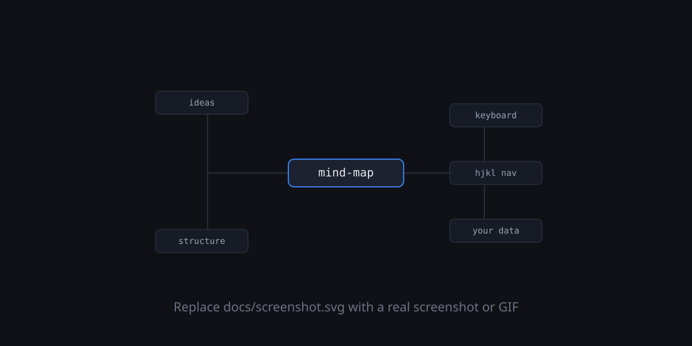

# mindmap-mcp

**A local mind-map canvas any MCP-capable LLM can co-edit live, while you edit it too.**

Open a map in your browser, connect Claude Code, Claude Desktop, Codex, opencode — or any
other [MCP](https://modelcontextprotocol.io) client — and develop ideas together: the AI
adds, restructures, and connects nodes through the MCP server; every change streams onto
your canvas instantly and lands in your undo history (`⌘Z` reverts an AI edit like your
own). You keep editing by hand the whole time — on conflicts, your version wins.

Underneath it's a keyboard-first, [XMind](https://xmind.app)-style mind mapper: every
action has a hotkey, and each map is a human-readable JSON file that's friendly to git and
backups. Everything runs on your machine — no API keys, no external services, no cloud.

[](LICENSE)

<!-- Placeholder art. Replace docs/screenshot.svg with a real screenshot or GIF (a .png/.gif is fine — just update the path below). -->
<p align="center"></p>

## How it works

Maps are plain JSON files. One small local server exposes them two ways at once: to your
**browser** (the canvas) and to your **LLM** (the MCP server). AI edits are surgical
operations — add/move/edit/delete nodes, draw relationship arrows, atomic batches —
broadcast over SSE to the open tab and replayed through the same undo pipeline as your
keystrokes. See [ARCHITECTURE.md](ARCHITECTURE.md) for the full picture.

## Requirements

- [Node.js](https://nodejs.org) 20+ and [pnpm](https://pnpm.io) 9+ (`npm install -g pnpm`)
- macOS or Linux. On Windows, use [WSL](https://learn.microsoft.com/windows/wsl/) — the
  CLI relies on Unix conventions and is untested natively.

## Install

```bash
git clone https://github.com/joanclaverol/mind-map.git && cd mind-map
pnpm install && pnpm build
pnpm add -g link:.        # exposes the `mindmap` command (symlinks to this clone)
```

Check it worked:

```bash
mindmap                   # prints usage — if "command not found", see Troubleshooting
```

That's the whole install. Updating later is `git pull && pnpm install && pnpm build`.

## Step 1 — Run the app and make a first map

```bash
pnpm dev                  # hot reload; or `pnpm start` for the built app
```

Open <http://localhost:5454>. You land in the gallery — press `n`, type a title, `Enter`.
On the canvas: `Tab` adds a child, `Enter` a sibling, just **type** to replace the selected
node's text, `hjkl` or arrows to move around, `?` shows every hotkey. Maps autosave to
`maps/*.json` as you type.

Leave this running and the browser tab open — that's your half of the co-editing session.

## Step 2 — Connect your AI

`mindmap config` prints ready-to-paste config for every supported client; pass a name for
just one:

```bash
mindmap config claude-code     # or: claude-desktop | codex | opencode
```

Each client offers two transports — **pick the right one for what you want**:

| Transport | What it is | When to use it |
| --- | --- | --- |
| **HTTP** — `http://localhost:5454/mcp` | Connects to the running app — the same process your browser is looking at. | **For live co-editing.** AI edits stream onto your open canvas. Requires step 1 to be running. |
| **stdio** — `node <repo>/bin/mindmap.js stdio` | The client spawns its own headless server on demand. | For map access without the app running (e.g. Claude Desktop reading/writing your library). Edits land in the files but **won't appear live** in a browser tab — it's a separate process. |

Copy-paste setup per client (replace `/path/to/mind-map` with your clone; `mindmap config`
prints these with the real path filled in):

**Claude Code**

```bash
claude mcp add --transport http mindmap http://localhost:5454/mcp   # live co-editing
# or, no running app needed:
claude mcp add mindmap -- node /path/to/mind-map/bin/mindmap.js stdio
```

**Claude Desktop** — add to `~/Library/Application Support/Claude/claude_desktop_config.json`
(Linux: `~/.config/Claude/claude_desktop_config.json`), then restart Claude Desktop:

```json
{ "mcpServers": { "mindmap": { "command": "node", "args": ["/path/to/mind-map/bin/mindmap.js", "stdio"] } } }
```

> `mindmap config claude-desktop` prints this with the absolute path to your Node binary —
> use that version if Claude Desktop can't find `node` (GUI apps don't see your shell PATH).

**Codex CLI** — add to `~/.codex/config.toml`:

```toml
[mcp_servers.mindmap]
url = "http://localhost:5454/mcp"      # live co-editing
# or stdio:  command = "node"  /  args = ["/path/to/mind-map/bin/mindmap.js", "stdio"]
```

**opencode** — add to `opencode.json` in your project:

```json
{ "mcp": { "mindmap": { "type": "remote", "url": "http://localhost:5454/mcp", "enabled": true } } }
```

Clients load MCP servers **at session start** — restart the client/session after adding.

## Step 3 — Your first co-editing session

With the map open in the browser and your client connected over **HTTP**, try:

> *"List my maps, open the one called X, and map out a launch plan for a weekend project."*

Nodes appear on your canvas as the AI writes them. Then push it further:

> *"Review this map: mark open questions with ❓ and a short note, tag everything
> launch-critical, and color decided items sage."*

> *"These three ideas don't belong under marketing — pull them out into a floating tree
> and connect it to the budget node with an arrow labeled 'depends on'."*

While it works: keep editing by hand, drag nodes around, and press `⌘Z` any time — an AI
edit (even a 50-op batch) is one undo step, and your version always wins on conflicts.
Press `⇧I` to see the notes and tags the AI attached.

## Use it inside another project

For maps that belong to a *different* repo (a repo analysis, a presentation outline…),
run an ephemeral instance from that directory:

```bash
cd ~/your/other/project
mindmap claude    # serve ./mindmaps on a free port, open the browser,
                  # launch Claude Code with the tools injected; teardown on exit
mindmap up        # same server, foreground — prints the URL + config so you can
                  # connect any other client yourself
```

The only thing left in the host repo is `mindmaps/` — plain map JSON, meant to be
committed so the maps version with that project. Session files live in `.mindmap/`,
auto-added to `.git/info/exclude`.

## What your AI can do

The MCP server (full guide for models: [MCP.md](MCP.md)) exposes the whole editing surface:

| | Tools |
| --- | --- |
| Read | `read_map`, `read_map_markdown` (id-annotated + arrows), `get_subtree`, `list_maps` |
| Search | `find_nodes` — locate ideas by text and/or tags across one or **all** maps without reading them whole |
| Edit nodes | `add_nodes`, `edit_node`, `move_node`, `delete_node` |
| Annotate | `set_node_meta` — color, icon, hidden note, tags; renders quietly on the canvas |
| Floating trees | `create_tree`, `detach_node` — detached trees on the canvas; `move_node` on a tree root attaches it |
| Connect ideas | `add_relationship`, `edit_relationship`, `delete_relationship` — labeled arrows between any two nodes, across trees |
| Batch | `apply_ops` — up to 50 edits, atomic on disk, **one undo step** for you |
| Create | `create_map_from_outline` |

## Features

- **Live AI co-editing** — any MCP client edits the open map; changes stream in, undoable.
- **Keyboard-first editing** — add, navigate, reorder, and restructure without the mouse.
- **Four layouts** — logic chart, balanced map, org chart, and a Now/Next/Later roadmap;
  cycle per-map with `⇧S`.
- **Floating trees** — several root trees on one canvas (XMind floating topics): brainstorm
  clusters side by side, connect them with arrows, attach/detach branches by dragging.
- **Relationship arrows** — free directional links between any two nodes, across trees.
- **Inline markdown** in node text: bold, italic, code, strike, highlight, links.
- **Node metadata, quietly** — an emoji before the text, a subtle color tint from a small
  muted palette, a dot for hidden notes, searchable tags; all editable in the `⇧I`
  inspector and prime territory for your AI to mark status (❓ open, ✅ decided…).
- **Markdown interop** — copy a branch as a nested list; paste any outline (Obsidian, Notes,
  XMind exports) as a subtree.
- **Local-first storage** — one JSON file per map, no database, no cloud.

New to the code? Start with [ARCHITECTURE.md](ARCHITECTURE.md), then
[CONTRIBUTING.md](CONTRIBUTING.md).

## Hotkeys

| Key | Action |
| --- | --- |
| `Tab` | Add child and edit it |
| `Enter` / `Shift+Enter` | Add sibling below / above and edit it |
| `Space` or `F2` | Edit selected node (cursor at end) |
| *type any character* | Edit selected node, replacing its text (XMind behavior) |
| `Enter` / `Esc` (while editing) | Commit (`Shift+Enter` inserts a line break) |
| `Delete` / `Backspace` | Delete subtree |
| `h j k l` or arrows | Navigate by screen direction (toward root / down / up / deeper — adapts to the layout structure) |
| `⇧J` / `⇧K` | Move node down / up on screen (reorder; nest/un-nest in org chart) |
| `⇧L` / `⇧H` | Move node right / left on screen (nest/un-nest; reorder in org chart) |
| `⇧S` | Cycle layout structure: right tree → balanced map → org chart → roadmap (per map, undoable) |
| `⇧N` | New **floating tree** at the view center (a detached tree on the same canvas — connect it later with arrows, or drag it onto a node to attach) |
| `⇧I` | **Node inspector** — view/edit the selected node's color, icon, note, and tags (panel follows the selection; Esc closes) |
| `/` | Collapse / expand branch |
| `⇧A` | Draw an **arrow** (relationship) from the selected node — move (`hjkl`/click) to a target, `Enter` to connect, `Esc` to cancel; the label editor opens on connect |
| `⌘C` / `⌘X` / `⌘V` | Copy / cut branch as markdown outline · paste outline as subtree |
| `⌘Z` / `⌘⇧Z` | Undo / redo |
| `⌘=` / `⌘-` / `⌘0` | Zoom in / out / fit |
| `Esc` | Back to gallery |
| `?` | Keyboard cheatsheet — every bound command, generated from the live keymap (works in the gallery too) |

**Mouse:** scroll to pan, pinch (or `⌃`+scroll) to zoom at cursor, drag empty canvas to pan,
double-click a node to edit, **double-click empty canvas to create a floating tree right
there**. **Drag a node** to restructure: the middle of another node nests the branch inside
it (expands collapsed targets), the top/bottom edge inserts it between siblings (a blue line
shows where), and dropping it on **empty canvas** (beyond ~48px of any node — a dashed ghost
shows the spot) **detaches it into a floating tree**. Drag a floating tree's root onto a node
to attach the whole tree, or to empty canvas to reposition it. `Esc` cancels a drag.
**Click an arrow** (or its label) to select it — `Enter` edits its label, `Delete`/`Backspace`
removes it, `Esc` deselects.

> Because `⇧HJKL` move, `⇧A` draws an arrow, `⇧I` opens the inspector, `⇧N` adds a floating
> tree, and `⇧S` switches structure, typing a *capital* A/H/I/J/K/L/N/S won't trigger
> type-to-edit — press `Space` to edit instead, or unbind them via `localStorage.keymap`.

## Gallery

The `Esc` screen is a keyboard-driven map menu in three sections: **Pinned** (curated by
title; `p` toggles a pin, stored in the map file), **Recent** (last five opened, tracked in
`localStorage` so map files stay diff-clean), and **All** (everything else by last edit).

| Key | Action |
| --- | --- |
| `j` / `k` or arrows | Move selection |
| `Enter` | Open the selected map |
| `/` | Fuzzy-search titles; `Esc` clears |
| `n` | New map (focus the title input) |
| `p` | Pin / unpin |
| `r` | Rename inline |
| `d` | Delete (confirms first) |
| `?` | Keyboard cheatsheet |

## Maps & storage

Each map is a pretty-printed JSON file in `maps/`, named `<id>.json` — one file per map,
human-readable, easy to diff and back up. There's no database. The schema is documented in
[ARCHITECTURE.md](ARCHITECTURE.md#data-model). Your own map files stay on your machine; only
the demo `welcome.json` is committed to this repo. Per-project sessions store their maps in
that project's `mindmaps/` folder instead. Override the directory anytime with the
`MAPS_DIR` env var (and the port with `PORT`).

## Troubleshooting

| Symptom | Fix |
| --- | --- |
| `mindmap: command not found` after install | The global bin dir isn't on your PATH — run `pnpm setup`, restart the shell, then `pnpm add -g link:.` again. Or skip the CLI and use the repo paths directly. |
| `mind-map isn't built — run "pnpm build"` | The CLI serves the compiled UI: run `pnpm build` in the repo once (and after every `git pull`). |
| The client doesn't list the mindmap tools | MCP servers load at session start — restart the client/session after adding the config. In Claude Code, check with `/mcp`. |
| AI edits don't appear in my browser | You're connected over **stdio**, which is a separate headless process. Switch the client to the **HTTP** config (`http://localhost:5454/mcp`) and make sure the app from step 1 is running. |
| Claude Desktop says it can't start the server | GUI apps don't inherit your shell PATH — use the absolute Node path that `mindmap config claude-desktop` prints. |
| Port 5454 is busy | Another instance owns it. Stop it, or run with `PORT=5460 pnpm start` and point the client at the new port. `mindmap up` picks a free port automatically. |
| Browser tab shows "Autosave failed" after updating | The tab predates a schema upgrade — reload it. |
| Two people/tools editing the same map | It's a single-user local tool: the browser wins conflicts, and simultaneous browser tabs on one map are last-write-wins. |

## Documentation

- **[ARCHITECTURE.md](ARCHITECTURE.md)** — how it's built: frontend, server, data model,
  layout, the command/undo-redo pattern, and a diagram.
- **[CONTRIBUTING.md](CONTRIBUTING.md)** — setup, conventions, how to add a feature.
- **[MCP.md](MCP.md)** — the guide AI models read: every tool, the schema, and workflows.

## License

[MIT](LICENSE) © 2026 Joan Claverol
